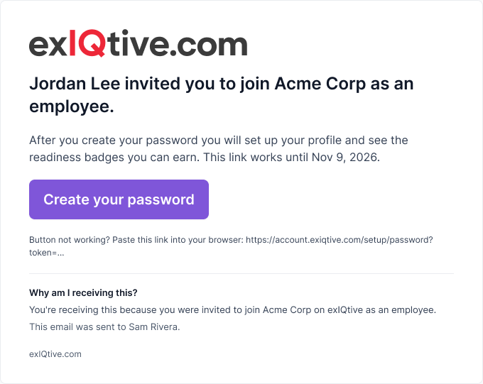
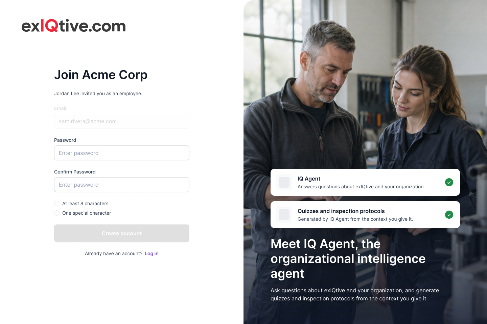
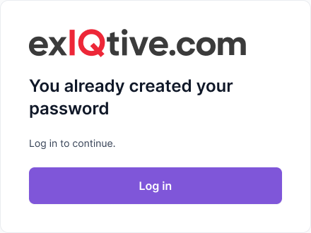
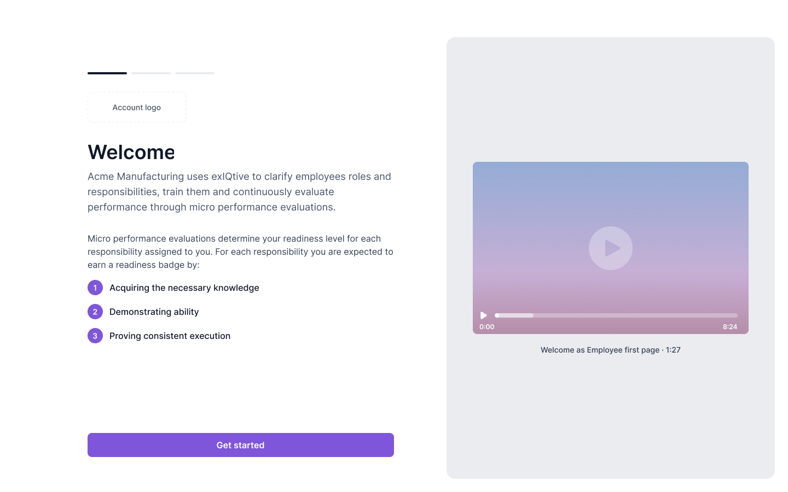
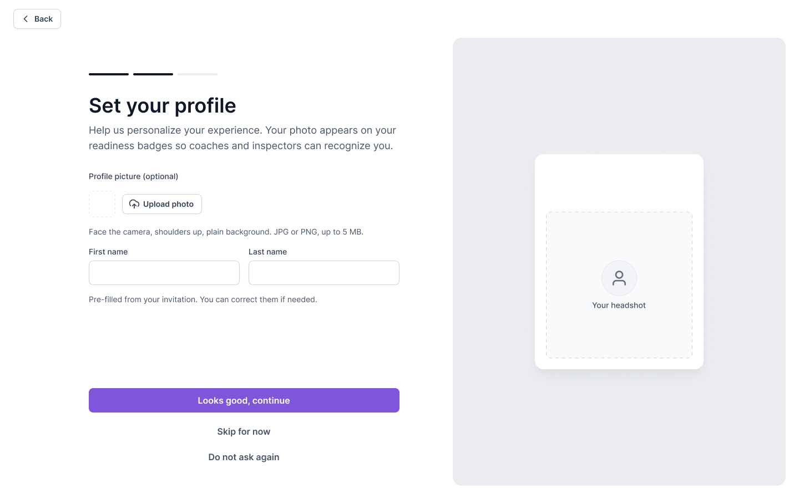
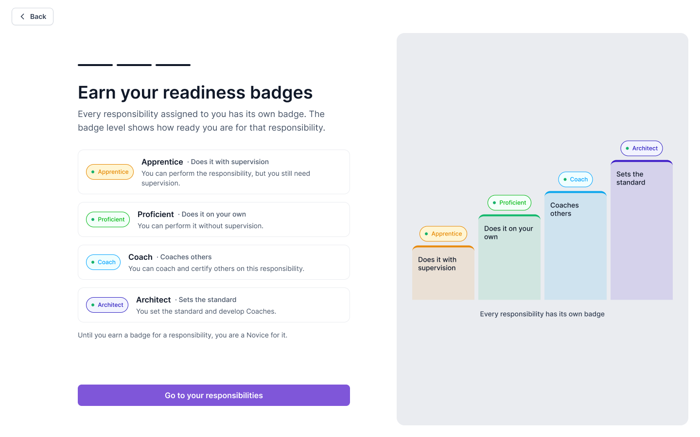
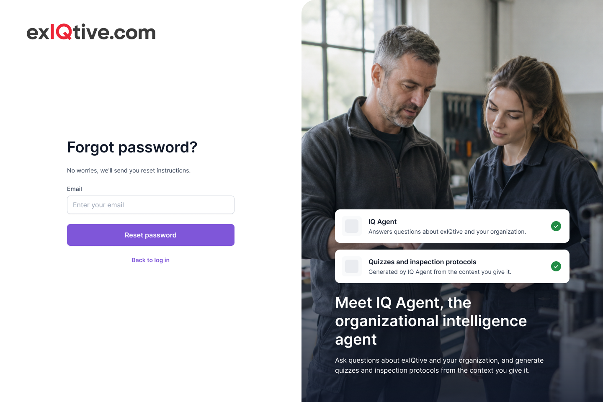

Your administrator gives you access by sending you an invitation email. This page takes you from that email to your first sign-in.

## Accept your invitation

The invitation email names the person who invited you, your company's account, and the date the link expires.

<Frame>
  
</Frame>

<Steps>
  <Step title="Open the link">
    Select the button in the email. If the button doesn't work, paste the link shown under it into your browser.
  </Step>
  <Step title="Check the Join page">
    The page shows **Join** and your company's name, who invited you, and your email address. You can't change the email here.
  </Step>
  <Step title="Create your password">
    Enter your password in **Password** and again in **Confirm Password**. Use the eye icon to show what you typed. Follow the password rules shown on the page.
  </Step>
  <Step title="Create your account">
    Select **Create account**. You're signed in straight away, and your welcome wizard starts.
  </Step>
</Steps>

<Frame>
  
</Frame>

<Tip>
  The link works once. If you open it again after creating your password, the page says **You already created your password** and offers **Log in**.

  <Frame>
    
  </Frame>
</Tip>

## If something goes wrong

| What you see | What to do |
| --- | --- |
| The link has expired | Ask your administrator to resend the invitation, or request a new link from the page. |
| **You're signed in as** someone else | Choose **Sign out and continue** to join with the invited email, or **Stay signed in** to keep the other session. |
| **Try again in** a set time | You made too many attempts. Wait until the time shown, then try again. |
| **You're all set** with **Continue to log in** | Your password is saved. Select **Continue to log in** and sign in with your email. |

## Your welcome wizard

The first time you sign in, a short welcome wizard shows you around:

<Tabs>
  <Tab title="1. Welcome">
    **Welcome** explains what exIQtive.com does for you.

    <Frame>
      
    </Frame>
  </Tab>
  <Tab title="2. Set your profile">
    **Set your profile** confirms your first and last name and lets you add a profile photo. The photo is optional.

    <Frame>
      
    </Frame>
  </Tab>
  <Tab title="3. Earn your readiness badges">
    **Earn your readiness badges** explains the four badge levels you can earn on each responsibility: Apprentice, Proficient, Coach and Architect. Until you earn a badge for a responsibility, you're a Novice for it.

    <Frame>
      
    </Frame>
  </Tab>
</Tabs>

On **Set your profile** you can select **Skip for now** to see it again next time, or **Do not ask again** to stop seeing it. When the wizard ends, you land on your responsibilities in **Your Stuff**.

If you're also an administrator, you see a few extra steps for setting up the account.

## Sign in later

Go to exIQtive.com, enter your email and password, and select **Log in**.

### Forgot your password

<Steps>
  <Step title="Ask for a reset link">
    On the sign-in page, select the forgot password link and enter your email, then select **Reset password**. You receive an email with a reset link.

    <Frame>
      
    </Frame>
  </Step>
  <Step title="Set a new password">
    Open the link and enter your new password twice on the **Set new password** page.
  </Step>
  <Step title="Sign in">
    Go back to the sign-in page and log in with your new password.
  </Step>
</Steps>

## Related

<CardGroup cols={2}>
  <Card title="Employee quickstart" icon="rocket" href="/get-started/employee-quickstart">
    Your first day in exIQtive.com.
  </Card>

  <Card title="Your Stuff" icon="layout-dashboard" href="/employees/your-stuff">
    Where your responsibilities, tasks and inspection requests live.
  </Card>
</CardGroup>
