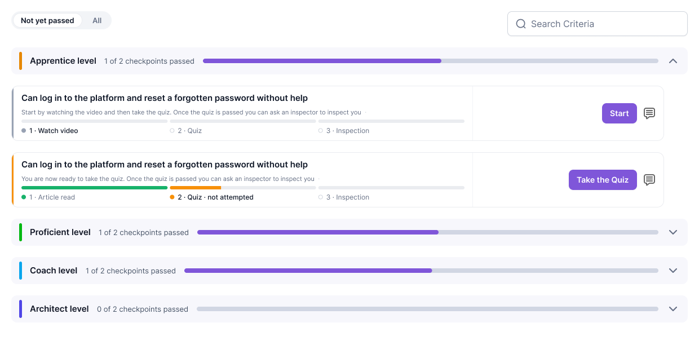
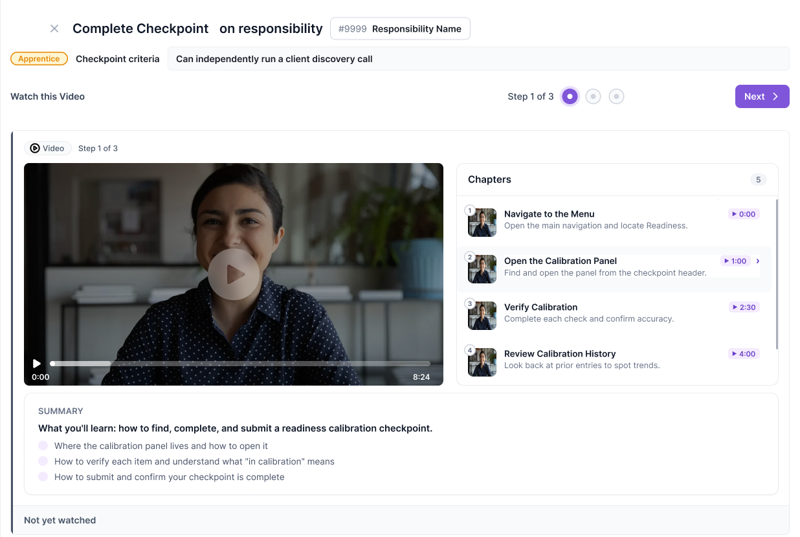
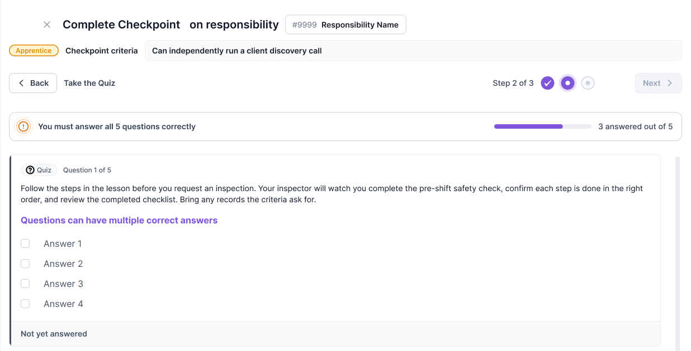
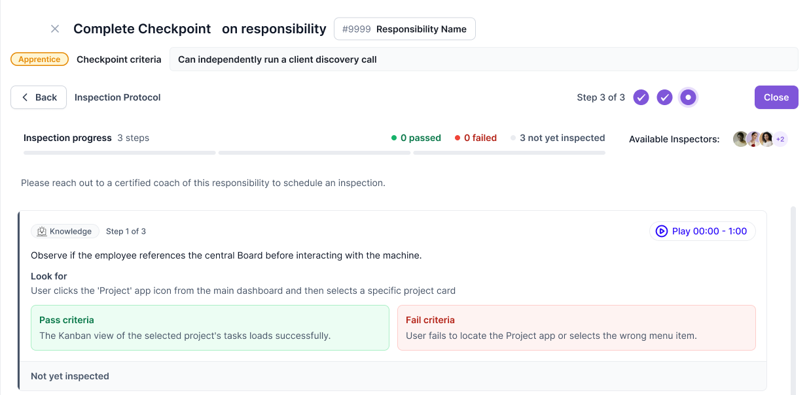

Each responsibility has a checklist of **checkpoints**: the things you need to know and do to perform it well. You prepare by working through those checkpoints. Some you complete on your own with a quiz. Others need a Coach to inspect you.

## Open the checklist

<Steps>
  <Step title="Go to your responsibilities">
    Open **Your Stuff → As Employee → Your Responsibilities**.
  </Step>
  <Step title="Select Prepare">
    On the responsibility's row, select **Prepare**. The responsibility opens on its **Checklist** tab.
  </Step>
</Steps>

Checkpoints are grouped by badge level: Apprentice, Proficient, Coach and Architect. The lowest level you haven't finished opens first. The others stay collapsed until you open them.

Use **Not yet passed** to see only what's left in the open level, or **All** to see every checkpoint in it. The search box filters by checkpoint name.

<Frame>
  
</Frame>

Each checkpoint shows its stages, such as **Watch video**, **Quiz** and **Inspection**, and how far you've got. Select **Start**, or the button for your next stage, to open it.

## Complete a checkpoint

Select a checkpoint to open it. The panel walks you through it step by step, and shows where you are, such as **Step 1 of 3**. Use the arrows at the top to move to the previous or next checkpoint without closing the panel.

<Steps>
  <Step title="Watch or read">
    Watch the video or read the article. A video lists its chapters beside it, so you can jump to the part you need. When you've finished, select **Next**.

    <Frame>
      
    </Frame>
  </Step>
  <Step title="Take the quiz">
    Answer every question, then submit. You pass when every answer is correct. Some questions have more than one correct answer. If you don't pass, you see which answers were wrong, and you can try again as many times as you need.

    <Frame>
      
    </Frame>
  </Step>
  <Step title="See what's next">
    What happens after you pass depends on the checkpoint. See below.
  </Step>
</Steps>

### After you pass the quiz

| The checkpoint needs | What you see |
| --- | --- |
| A quiz only | **Checkpoint passed**. You're done with this checkpoint. |
| A quiz and an inspection | The inspection step: the protocol steps your Coach will check, and the inspection status. When you're ready, contact a Coach for the responsibility to schedule the inspection. |

<Frame>
  
</Frame>

Some checkpoints have no video, article or quiz. They list what the Coach will check, so you know what to practice before you're inspected.

## When you're ready

When you've worked through a level's checkpoints and feel ready, contact a Coach for that responsibility to schedule an inspection. **Available Inspectors** on **Your Responsibilities** shows who can inspect you. When you pass, you earn the badge for that level. See [The Badge Ladder](/user-guide/readiness/badge-ladder).

## Common questions

<AccordionGroup>
  <Accordion title="Is there a limit on quiz attempts?">
    No. You can retake a quiz as many times as you need, with no waiting time.
  </Accordion>

  <Accordion title="Does watching the video pass the checkpoint?">
    No. Watching or reading prepares you. A checkpoint passes when you pass its quiz, or when a Coach passes it during an inspection.
  </Accordion>

  <Accordion title="Can I come back later?">
    Yes. Close the panel at any time. When you open the checkpoint again, you pick up where you left off.
  </Accordion>
</AccordionGroup>

## Related

<CardGroup cols={2}>
  <Card title="Inspecting a responsibility" icon="search-check" href="/coaching/inspecting-a-responsibility">
    What the Coach does during your inspection.
  </Card>

  <Card title="Checkpoints" icon="list-check" href="/checkpoints/overview">
    How checkpoints are built.
  </Card>
</CardGroup>
