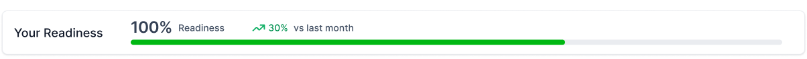
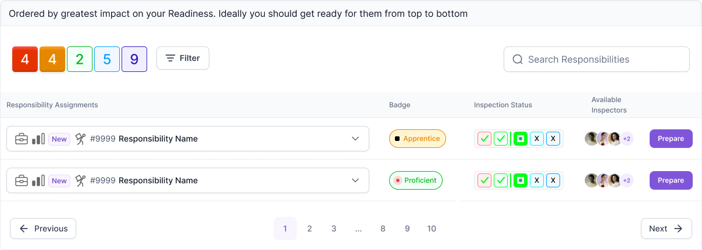

**Your Stuff** is your own area in exIQtive.com. Everything here is about you: the responsibilities you hold, the badges you've earned, your Readiness, and the work waiting for you. If you're an employee without admin permissions, it's the main place you use.

## As Employee

**Your Stuff → As Employee** opens with **Your Readiness** at the top: your overall Readiness percentage, and how it changed since last month.

<Frame>
  
</Frame>

Your overall Readiness is the weighted average of your badges on your responsibilities. See [How Readiness is calculated](/user-guide/readiness/how-readiness-is-calculated).

Below it are three tabs.

### Your Path to Readiness

Your readiness for your primary position, and for any position you're preparing for.

### Your Responsibilities

Every responsibility you hold, through your position and its roles, appears here as one row. The most important ones come first, so work from the top down.

<Frame>
  
</Frame>

Each row shows:

- The responsibility's name
- Your badge for it, if you have one
- The Coaches who can inspect you on it, under **Available Inspectors**
- **Prepare**, which opens the responsibility's checklist

Use **Filter** and the search box to narrow the list. See [Prepare on a responsibility](/employees/prepare-on-a-responsibility).

A banner at the top warns you when a badge is about to expire, so you can get re-inspected in time.

### Your Badges

Every badge you've earned, one per responsibility.

## Your Tasks

**Your Stuff → Your Tasks** lists the tasks assigned to you, such as uploading a video for a checkpoint or registering a QR code. See [Tasks](/readiness/tasks).

## As a Coach and As an Architect

If you hold a Coach or Architect badge on a responsibility, you also see **As a Coach** or **As an Architect** in Your Stuff. See [What is a Coach?](/coaching/what-is-a-coach) and [What is an Architect?](/coaching/what-is-an-architect).

## Ask IQ

**Ask IQ** is available to everyone. Ask it how something works in exIQtive.com or what a responsibility involves. See [Ask IQ](/iq/ask-iq).

## Common questions

<AccordionGroup>
  <Accordion title="I don't see any responsibilities">
    You see responsibilities only once you're assigned to a position that has roles with active responsibilities. Ask your administrator to check your position.
  </Accordion>

  <Accordion title="Why does the same responsibility appear twice?">
    You hold it through two different roles or positions. Each one is counted separately.
  </Accordion>

  <Accordion title="Can I change my responsibilities?">
    No. Your responsibilities come from your position. Your administrator manages positions and roles.
  </Accordion>
</AccordionGroup>

## Related

<CardGroup cols={2}>
  <Card title="Prepare on a responsibility" icon="book-open-check" href="/employees/prepare-on-a-responsibility">
    Study, take quizzes and get ready for inspection.
  </Card>

  <Card title="The Badge Ladder" icon="stairs" href="/user-guide/readiness/badge-ladder">
    The five levels and how you earn each one.
  </Card>
</CardGroup>
