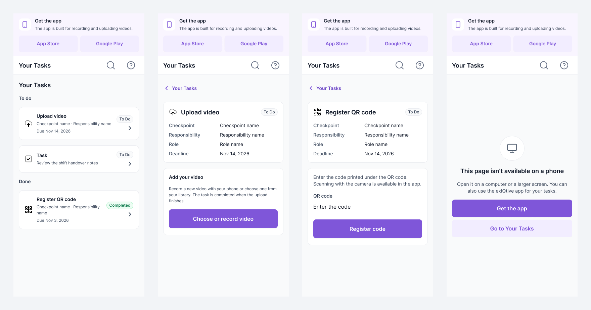

You can use exIQtive.com on your phone in three ways:

| Way to use it | Where |
| --- | --- |
| **iOS app** | Download it from the App Store |
| **Android app** | Download it from Google Play |
| **Phone web browser** | Open exIQtive.com in your phone's browser, with nothing to install |

Your account and data are the same on every device, so you can switch between your phone and your computer at any time.

## In your phone's browser

On a phone, the browser shows **Your Tasks**: the tasks assigned to you, and the details of each one. When an email links you to a task, it opens straight on that task after you sign in.

<Frame>
  
</Frame>

From your phone's browser you can:

- **Mark a task done.**
- **Upload a video.** Record a new one or choose one from your phone, and the task completes when the upload finishes.
- **Register a QR code.** Type the code printed under the QR code.

Other pages, such as Your Responsibilities, open on a computer or a larger screen. On a phone they say **This page isn't available on a phone**, with buttons to get the app or go back to Your Tasks.

A **Get the app** banner at the top links to the App Store and Google Play.

## What the mobile apps add

The mobile apps are built for recording and uploading videos, and they use your phone's camera. For example, when a task asks you to register a QR code, you scan the code instead of typing it. See [Tasks](/readiness/tasks).

## Related

<CardGroup cols={2}>
  <Card title="Employee quickstart" icon="rocket" href="/get-started/employee-quickstart">
    Get started as an employee.
  </Card>

  <Card title="Tasks" icon="list-checks" href="/readiness/tasks">
    Complete the tasks assigned to you.
  </Card>
</CardGroup>
