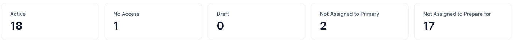
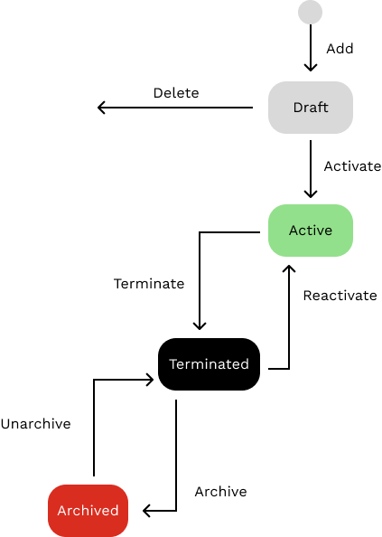
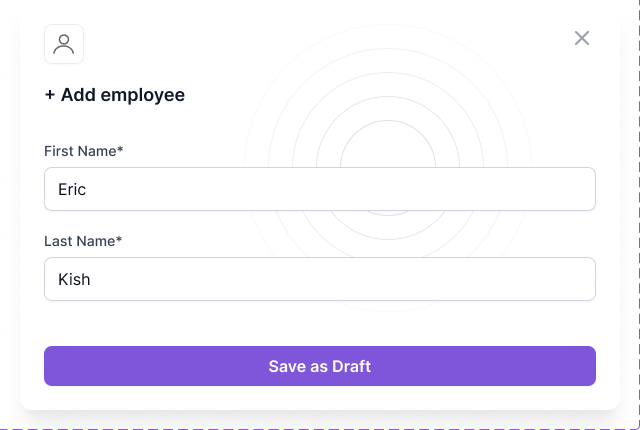
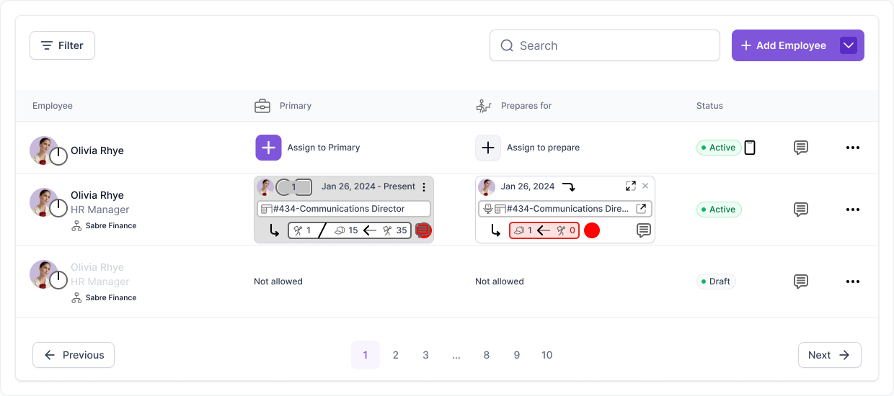
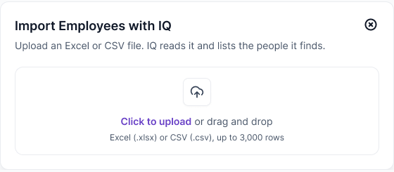
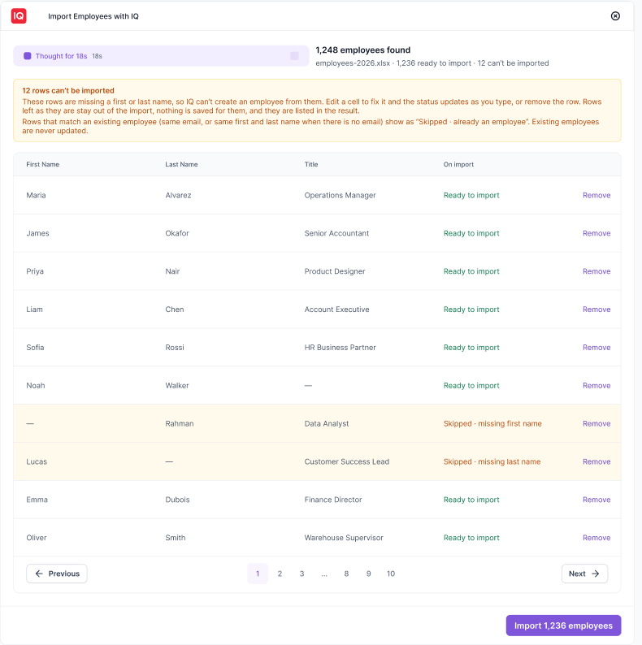
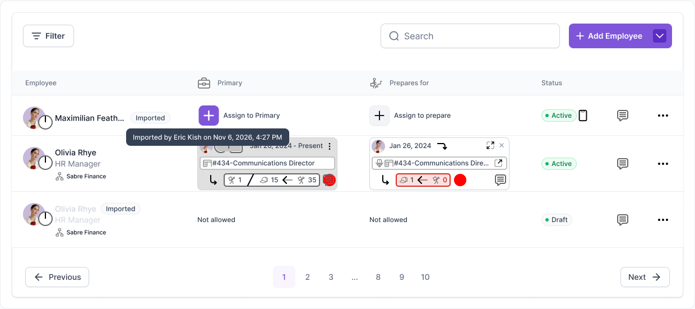
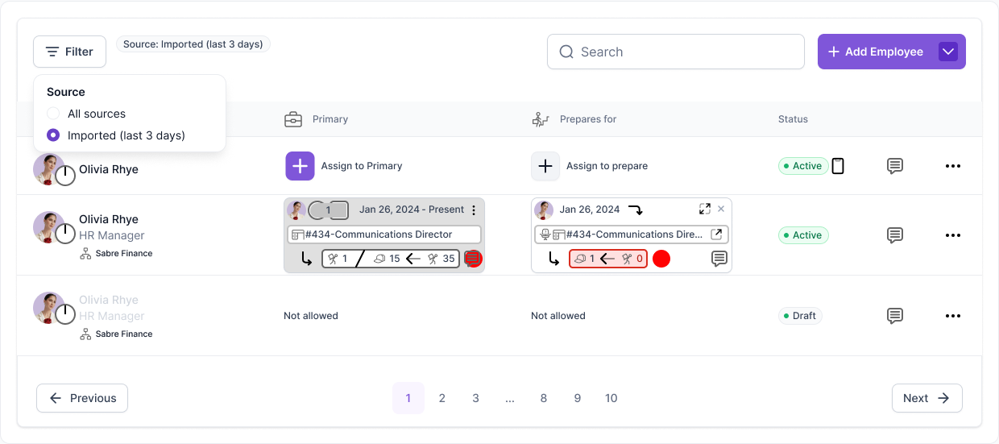
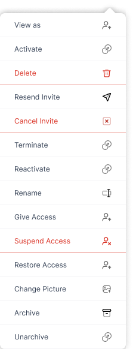
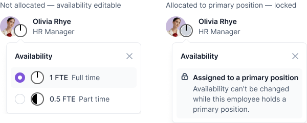

Every employee in exIQtive.com has two independent things going on at once: their **Employee Status** (where they are in the employment lifecycle) and their **Access Status** (whether they can log in to the portal and see their Readiness). This page explains both, and how to manage employees day to day.

Go to **Organization → Employees** to manage your employees.

## Header dashboard

A row of count tiles sits above the Employees table. Use it to see at a glance how many employees need attention.

<Frame>
  
</Frame>

| Tile | What it counts |
| --- | --- |
| **Active** | Employees with Active status. |
| **No Access** | Employees who haven't been given portal access yet. Clicking it shows the Active ones. |
| **Draft** | Employees with Draft status. |
| **Not Assigned to Primary** | Active employees with no Primary Position. |
| **Not Assigned to Prepare for** | Active employees who aren't preparing for a position. Hidden when Readiness isn't turned on. |

Terminated and Archived employees aren't counted.

Click a tile to filter the table to that group. The tile replaces all your other filters and your search. Click the same tile again to return to the default view of Draft and Active employees.

## Employee Status and Access Status

- **Employee Status** — where they are in their employment lifecycle: Draft, Active, Terminated, or Archived.
- **Access Status** — whether they can log in to the portal and see their Readiness.

You manage these separately. An employee can be Active but have no portal access because you haven't given it to them yet. An employee can have access while still in Draft because you set up their login before activating them. They're independent by design, so you can handle each at the right moment.

## Employee Status

Employee Status controls whether an employee can be assigned to positions and whether they count as active in the organization.

<Frame>
  
</Frame>

| Status | What it means |
| --- | --- |
| **Draft** | Just created. Can't be assigned to a position yet, and can still be deleted. |
| **Active** | Ready to work. Can be assigned to positions and inherits responsibilities through them. |
| **Terminated** | No longer active and removed from all position assignments. Can be reactivated or archived. |
| **Archived** | Long-term storage. All history is preserved, and the employee is no longer assignable. Unarchive returns the employee to Terminated. |

## Access Status

Access Status tells you whether an employee can log in to the portal and see their Responsibilities, badges, and Readiness. Giving access is a deliberate step you take when the employee is ready to use the platform.

| Dot color | What it means |
| --- | --- |
| Empty | No access given yet. You haven't sent an invitation. |
| Blue | Invitation sent. Waiting for the employee to sign up. |
| Green | Signed up. The employee can log in. |
| Red | Access suspended. The employee is temporarily blocked from logging in. |
| Black | Email blocked by the system administrator across all accounts. |

## Add a new employee

<Steps>
  <Step title="Open Employees">
    Go to **Organization → Employees**.
  </Step>
  <Step title="Add the employee">
    Click **+ Add Employee** and enter the employee's first and last name.

    <Frame>
      
    </Frame>
  </Step>
  <Step title="Save">
    Click **Save as Draft**.
  </Step>
</Steps>

The employee is created in **Draft** status with no access. From there you can activate them, give them access, and assign them to a position, in whatever order suits your workflow.

To add many employees at once, see [Import employees with IQ](#import-employees-with-iq).

## Import employees with IQ

If you have a list of people in Excel or CSV, you don't need to type them in one by one. Upload the file and IQ reads it, finds the people in it, and shows them in a table for you to review. IQ only suggests. Nothing is saved until you select **Import**.

The file doesn't need a template. IQ works out which sheet and which columns hold the names, even when the columns are in any order, the header isn't on the first row, or a single column holds the full name.

If you can add employees, you can import them. **Import Employees with IQ** appears in the dropdown next to **\+ Add Employee**.

<Steps>
  <Step title="Open the import">
    Go to **Organization → Employees**. Open the dropdown next to **\+ Add Employee** and select **Import Employees with IQ**.

    <Frame>
      
    </Frame>
  </Step>
  <Step title="Upload your file">
    Click to upload, or drag and drop. The file must be Excel (`.xlsx`) or CSV (`.csv`) and can have up to 3,000 rows. Any other file type is rejected on the spot.

    <Frame>
      
    </Frame>
  </Step>
  <Step title="Wait while IQ reads the file">
    The window shows the file name and the number of rows while IQ reads it. When IQ finishes, the people it found appear in a table.
  </Step>
  <Step title="Review and fix the table">
    The table has **First Name**, **Last Name** and **Title** columns, and an **Email** column when the file has email addresses. A missing value shows as **—**. Check each row's **On import** status, then edit or remove rows until you're happy. See [Review the table](#review-the-table).
  </Step>
  <Step title="Import">
    Select **Import N employees**. There's no confirmation step. The result shows what was imported and what was skipped.
  </Step>
</Steps>

### Review the table

Above the table you see how many rows are ready and how many can't be imported. If some rows can't be imported, a notice tells you how many. Those rows are left out and nothing is saved for them.

- **Edit a cell.** Click any cell and type. Press **Enter** or click away to save, or press **Esc** to cancel. Press **Tab** to move to the next cell.
- **Remove a row.** Select **Remove** on the row. The row disappears at once, with no confirmation.

The **On import** column updates as you edit, so you always see what will happen to each row.

<Frame>
  
</Frame>

| On import | What it means |
| --- | --- |
| **Ready to import** | The row will be imported. |
| **Skipped · missing first name** | The row has no first name. Add one to import it. |
| **Skipped · missing last name** | The row has no last name. Add one to import it. |
| **Skipped · already an employee** | This person is already an employee in your account. Existing employees are never updated. |
| **Skipped · duplicate in file** | The same person appears earlier in the file. Only the first row is imported. |
| **Checking…** | exIQtive.com is checking the row against your existing employees. |
| **Unverified** | The check didn't finish. Select **Retry**. If you import anyway, exIQtive.com checks the row again during the import. |

### What an import creates

- Employees are created in **Draft** status. They have no portal access, and exIQtive.com doesn't send any invitation or email.
- The title is saved as the employee's job title only. It doesn't create a position or assign the employee to one. To assign an employee, see [Employee/position assignments](/organization/employee-position-assignments).
- Email is saved when the file has one.
- The import is all or nothing. If it fails, no employees are created. You see an error, your edits are kept, and you can select **Retry import**.

When the import finishes, the result shows **N imported, N skipped**, with a tile for each reason rows were skipped and a **Skipped rows** table listing the first name, last name and reason. Select **Close** to return to the Employees list, which refreshes to show the new employees.

If you close the window before you import, exIQtive.com discards the run. Open the import again and upload the file again to start over.

### If IQ can't read the file

| Message | What to do |
| --- | --- |
| **This file type isn't supported** | Upload an `.xlsx` or `.csv` file. |
| **This file has too many rows** | Split the file so each part has 3,000 rows or fewer. |
| **IQ couldn't find any people** | Check that the file lists names, then upload a different file. |
| **IQ took too long to read this file** | Select **Retry**, or import a smaller file. Nothing was saved. |
| **IQ couldn't read this file** | Select **Retry**. Nothing was saved. |

### Find the people you just imported

For 3 days after an import, an **Imported** tag appears next to each new employee's name in the Employees list. Hover over the tag to see who imported the employee and when, for example "Imported by Eric Kish on Nov 6, 2026, 4:27 PM". The time is shown in your time zone. After 3 days the tag goes away. The tag doesn't change the employee's status.

<Frame>
  
</Frame>

To list only these employees, open the filter and choose **Imported (last 3 days)** under **Source**. Combine it with the **Draft** status filter to find a fresh import to review.

<Frame>
  
</Frame>

## Employee actions

All actions are in the three-dot menu (⋯) on the right of the employee's row.

<Frame>
  
</Frame>

The menu shows only the actions that apply to the employee's current status and access.

| Action | Available when | What it does |
| --- | --- | --- |
| **View as** | You're an Owner, Co-Owner or Administrator | Shows exIQtive.com as the employee sees it. For employees you can't view as, **Preview as** appears instead. See [View as](/account/view-as). |
| **Delete** | Draft only | Permanently removes the employee. Once activated, use Terminate instead. |
| **Activate** | Draft only | Makes the employee Active so they can be assigned to positions. |
| **Terminate** | Active only | Marks the employee Terminated, removes them from their position assignments, and automatically suspends their portal access. |
| **Reactivate** | Terminated only | Returns the employee to Active. Doesn't restore position assignments or portal access; do those separately. |
| **Archive** | Terminated only | Moves the employee to long-term storage. All history is preserved. |
| **Unarchive** | Archived only | Returns the employee to Terminated. |
| **Rename** | Always | Updates the employee's name. |
| **Change Picture** | Always | Uploads a profile picture for the employee. |
| **Give Access** | No access yet | Starts the invitation flow. Enter an email address and the employee receives a signup invitation. |
| **Resend Invite** | Invitation sent, not yet accepted | Sends the invitation email again. |
| **Cancel Invite** | Invitation sent, not yet accepted | Withdraws the invitation. |
| **Suspend Access** | Access is active | Immediately stops the employee from logging in. Their account is preserved and can be restored. |
| **Restore Access** | Access is suspended | Lets the employee log in again. |

## Employee availability

Every employee has an availability measured in FTE (Full-Time Equivalent): 1.0 for full-time, 0.5 for part-time. Availability determines which positions they can be assigned to.

To change it, click the availability icon next to the employee's name. You can change availability any time the employee is in Draft or Active status, **as long as they're not currently allocated to a Primary Position**. If they are, relieve them from that position first.

<Frame>
  
</Frame>

| Availability | FTE | Currently allocated |
| --- | --- | --- |
| Full-time, unallocated | 1.0 | 0 |
| Full-time, fully allocated | 1.0 | 1.0 |
| Part-time, unallocated | 0.5 | 0 |
| Part-time, fully allocated | 0.5 | 0.5 |
| External helper | 0 | Can't be assigned to positions |

## Common questions

<AccordionGroup>
  <Accordion title="What's the difference between Employee Status and Access Status?">
    Employee Status is about the employee's place in the organization: whether they can hold a position and receive responsibilities. Access Status is about their login: whether they can use the portal. You can have an Active employee with no portal access, or a Draft employee with an invitation already sent. Each is managed independently so you can set things up at your own pace.
  </Accordion>
  <Accordion title="Does importing employees with IQ update people who already exist?">
    No. If a row matches an employee who's already in your account, exIQtive.com skips it and doesn't change that employee. The skipped row appears in the result so you can see what was left out.
  </Accordion>
  <Accordion title="Does importing employees send invitations?">
    No. Imported employees are created as Draft with no portal access, and exIQtive.com sends no email. Give access later, one employee at a time, when you're ready.
  </Accordion>
  <Accordion title="Can I delete an employee I've already activated?">
    No. Once an employee is activated, deletion isn't available. Use Terminate instead, which preserves all their history. If you made a mistake and genuinely need to remove them, contact your Account Owner.
  </Accordion>
  <Accordion title="Why can't I change the employee's availability right now?">
    If the employee is currently allocated to a Primary Position, relieve them from that assignment first. Their availability has to match what the position requires, and changing it while they're allocated could break the assignment.
  </Accordion>
  <Accordion title="What happens to an employee's responsibilities when I terminate them?">
    They lose all their responsibilities immediately, because responsibilities flow through Position → Role → Responsibility and terminating removes them from their positions. Their badge history and Readiness records are fully preserved.
  </Accordion>
  <Accordion title="The blue invitation dot has been showing for a week. What should I do?">
    Follow up with the employee directly. The invitation may have landed in spam, or the email address may have a typo. Use **Resend Invite** in the employee's row menu, or on the [Account Users](/account/account-users) page (**Settings → Users**), to send a fresh one. If the address is wrong, use **Change Email** on the same page to correct it.
  </Accordion>
</AccordionGroup>

## Related

<CardGroup cols={2}>
  <Card title="Organization concepts" icon="network" href="/concepts/organization">
    The definitions behind employees, positions, and roles.
  </Card>
  <Card title="Employee/position assignments" icon="user-plus" href="/organization/employee-position-assignments">
    How to assign employees and how FTE matching works.
  </Card>
  <Card title="Positions" icon="briefcase" href="/organization/positions">
    Create and manage the positions employees fill.
  </Card>
  <Card title="Account users" icon="users" href="/account/account-users">
    Resend invites and change login emails.
  </Card>
</CardGroup>
