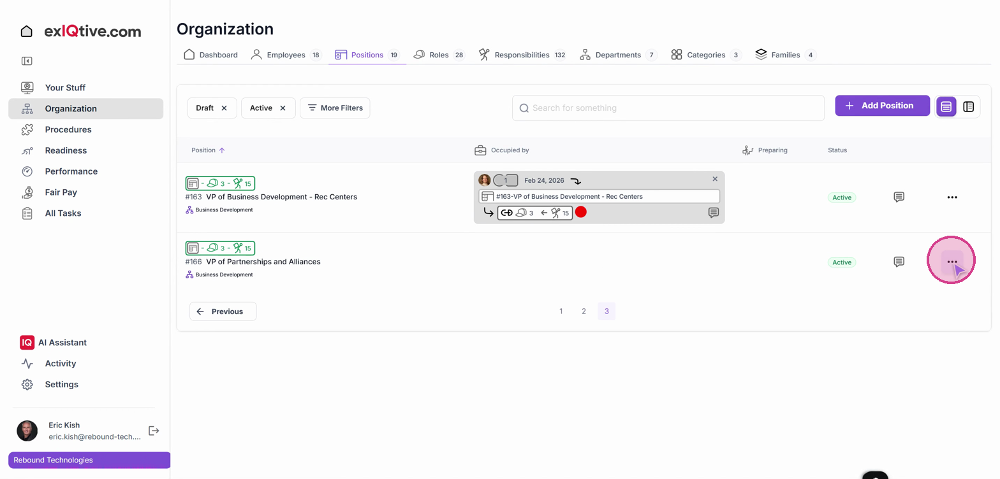
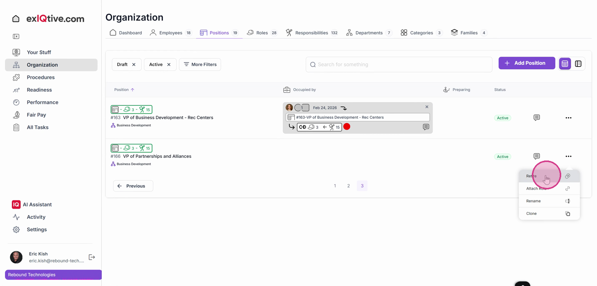
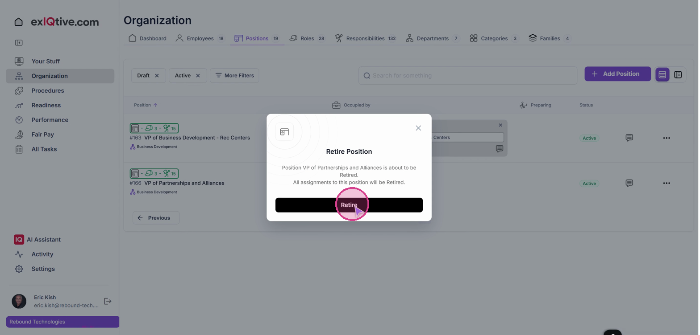

<iframe
  src="https://watchclueso.com/embed/em007q9963k21nva"
  title="How to retire a position"
  style={{ width: "100%", aspectRatio: "16/9", border: "none" }}
  allow="fullscreen; autoplay; picture-in-picture"
  allowFullScreen
/>

## Retire a Position Quickly and Efficiently

Retiring a position removes it from active status in your system. Use this feature when a position is no longer needed, ensuring your records stay current and clean.

<Note>
  Retire is unavailable while an employee is assigned to the position, whether as their Primary Position or as the position they're preparing for. Relieve those employees first.
</Note>

<Steps>
  <Step title="Open the position's menu">
    On **Organization → Positions**, open the **⋯** menu on the position's row.

    <Frame>
      
    </Frame>
  </Step>
  <Step title="Select Retire">
    Select **Retire** from the options.

    <Frame>
      
    </Frame>
  </Step>
  <Step title="Confirm">
    Click **Retire** in the **Retire Position** dialog. This finalizes the action.

    <Frame>
      
    </Frame>
  </Step>
</Steps>

Once you retire a position, it’s no longer active but stays in your records for reference. Use this action to keep your position list up to date and accurate.
